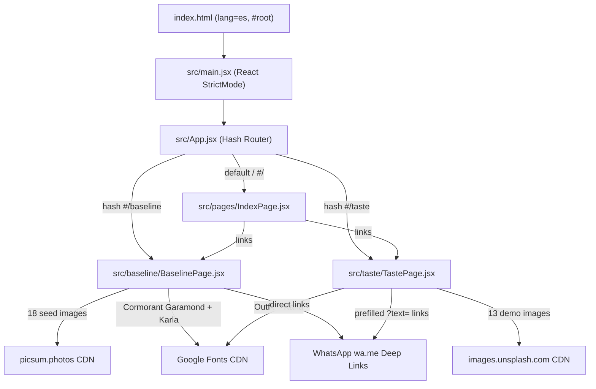

# Florería Paola AR — Design Taste Lab

**A controlled before-and-after front-end design experiment for a local boutique florist landing page (`Florería Paola AR`, CDMX).**

[Open the live comparison](https://floreria-paola-taste-lab.vercel.app) · [Jovan Franco](https://www.jovanfranco.com)

> **Portfolio classification:** Public non-production design laboratory (`AEAS-PRR-20261120` — *Showcases, Sandboxes, Labs, Websites & Demos*). This repository compares two client-side landing page executions of the same business proposition. It is **not** a production e-commerce website and does not process orders, payments, user accounts, or customer data.

---

## 1. Product Purpose & Problem Statement

### Purpose
Florería Paola AR — Design Taste Lab isolates visual and UX execution as a controlled comparison across two front-end surfaces served from a neutral selector index:

| Route | Component | Purpose |
| --- | --- | --- |
| `#/` (default) | [`src/pages/IndexPage.jsx`](src/pages/IndexPage.jsx) | Neutral selector linking independently to both versions |
| `#/baseline` | [`src/baseline/BaselinePage.jsx`](src/baseline/BaselinePage.jsx) | Preserved reference landing page (original layout, typography, palette, and copy) |
| `#/taste` | [`src/taste/TastePage.jsx`](src/taste/TastePage.jsx) | Redesigned landing page guided by [`.agents/skills/design-taste-frontend/SKILL.md`](.agents/skills/design-taste-frontend/SKILL.md) |

### Problem It Solves
Small-business landing pages often underperform not because essential information is absent, but because visual hierarchy, trust cues, mobile navigation, and conversion paths are poorly structured. Keeping the underlying Florería Paola AR offer constant allows reviewers to evaluate how hierarchy, typography, spacing, and contextual WhatsApp actions affect clarity and usability without conflating design quality with backend or traffic changes.

---

## 2. Capabilities & Current Implementation Boundary

### Implemented Capabilities (Verified in Code)
- **Hash-based comparison router ([`src/App.jsx`](src/App.jsx)):** Client-side hash routing (`#/` -> `IndexPage`, `#/baseline` -> `BaselinePage`, `#/taste` -> `TastePage`) with `hashchange` listener and automatic scroll-to-top on route transitions.
- **Neutral experiment selector ([`src/pages/IndexPage.jsx`](src/pages/IndexPage.jsx)):** Two-card Spanish-language launcher introducing the Baseline vs. Taste comparison.
- **Baseline reference surface ([`src/baseline/BaselinePage.jsx`](src/baseline/BaselinePage.jsx)):** Preserves the 13-part landing structure (Header, Mobile Drawer, Hero, Trust Strip, Services, Gallery, Occasions, 3-Step Ordering, Events, Value Pillars, Quote, Final CTA, Footer, and WhatsApp FAB) with `Cormorant Garamond` and `Karla` typography.
- **Redesigned Taste surface ([`src/taste/TastePage.jsx`](src/taste/TastePage.jsx)):** Applies an asymmetric services layout, forest-green (`#2D5A45`) and warm off-white (`#FAFAF7`) palette, `Outfit` and `Karla` typography, inline SVG icons (`WaIcon`, `CheckSvg`, `LeafSvg`), contextual URL-encoded WhatsApp messages (`wa()`), and explicit UI disclaimers (`Imagen de referencia`, `Imágenes de demostración`).
- **Evaluation & governance docs:** Structured multi-viewport rubric in [`docs/DESIGN_EVALUATION.md`](docs/DESIGN_EVALUATION.md), baseline preservation rules in [`CONTRIBUTING.md`](CONTRIBUTING.md), and testing boundaries in [`SECURITY.md`](SECURITY.md).

### Known Gaps & Pending Items
- **Static gallery filter pills on `#/baseline`:** [`src/baseline/BaselinePage.jsx`](src/baseline/BaselinePage.jsx) renders six category buttons (`Todos`, `Ramos`, `Eventos`, `Bodas`, `XV años`, `Condolencias`) without `onClick` handlers or filtering state (`Todos` remains permanently marked `is-active`). [`src/taste/TastePage.jsx`](src/taste/TastePage.jsx) removes those inactive pills and links each gallery card directly to WhatsApp.
- **Placeholder / demonstration imagery:** Neither variant uses authentic photographs of delivered Florería Paola AR arrangements (`#/baseline` loads `picsum.photos` seeds; `#/taste` loads Unsplash demonstration images).
- **No automated test suite or CI workflows:** No unit, component, or visual-regression tests exist in the repository.

---

## 3. Architecture & Tech Stack



### Stack (Verified in [`package.json`](package.json) & `.oxlintrc.json`)
- **UI Runtime:** React `^19.2.7`, React DOM `^19.2.7`
- **Build Tooling:** Vite `^8.1.1`, `@vitejs/plugin-react` `^6.0.3` (`vite.config.js`)
- **Language & Styling:** JavaScript (ESM `"type": "module"`) + component-scoped plain CSS (`src/index.css`, `IndexPage.css`, `BaselinePage.css`, `TastePage.css`)
- **Linting:** Oxlint `^1.71.0` configured in `.oxlintrc.json` (`react` and `oxc` plugins; `react/rules-of-hooks: error`, `react/only-export-components: warn`)
- **Type Definitions:** `@types/react` `^19.2.17`, `@types/react-dom` `^19.2.3` (editor/dev support)
- **Design Reference:** [`.agents/skills/design-taste-frontend/SKILL.md`](.agents/skills/design-taste-frontend/SKILL.md) (advisory design guidance for `#/taste`)

### Repository Layout
```text
.
├── .agents/skills/design-taste-frontend/   # Advisory frontend design skill reference
├── docs/DESIGN_EVALUATION.md               # 9-dimension design review rubric
├── public/                                 # Static assets (favicon.svg, icons.svg)
├── src/
│   ├── assets/                             # Template/static assets (not imported by comparison pages)
│   ├── baseline/                           # Preserved reference variant (BaselinePage.jsx / .css)
│   ├── pages/                              # Neutral selector route (IndexPage.jsx / .css)
│   ├── taste/                              # Redesigned variant (TastePage.jsx / .css)
│   ├── App.jsx                             # Hash-based router (#/, #/baseline, #/taste)
│   ├── index.css                           # CSS reset and .sr-only utility
│   └── main.jsx                            # React 19 entry point
├── CONTRIBUTING.md
├── SECURITY.md
├── index.html
├── package.json
└── vite.config.js
```

---

## 4. Integrations & External Dependencies

- **WhatsApp Business Deep Links (`https://wa.me/...`):** Both variants route quotes to three public business phone links (`525536329416`, `525624428572`, `525516458786`). `TastePage.jsx` appends contextual `?text=` payloads via `encodeURIComponent`. These are outbound client links only; no delivery or conversion telemetry is recorded.
- **External Image CDNs (Non-Production Demonstration Assets):**
  - `BaselinePage.jsx` loads 18 seeded placeholder images from `https://picsum.photos/seed/...`.
  - `TastePage.jsx` loads 13 externally hosted photos from `https://images.unsplash.com/photo-...` (explicitly marked in source comments as demonstration/reference imagery, not evidence of Florería Paola delivered work).
- **Google Fonts:** `BaselinePage.css` (`Cormorant Garamond`, `Karla`), `TastePage.css` (`Outfit`, `Karla`), and `IndexPage.css` (`Outfit`) import font stylesheets from `fonts.googleapis.com`.
- **Social Links:** `BaselinePage.jsx` links to generic platform roots (`facebook.com`, `instagram.com`, `tiktok.com`); `TastePage.jsx` links to `instagram.com/floreriapaolaar` and `facebook.com/FloreriaPaolaAR`.
- **No Backend Integrations:** Zero REST/GraphQL APIs, authentication, databases, payment processors, or analytics pipelines exist.

---

## 5. Local Setup & Commands

All commands below match [`package.json`](package.json) (`engines` is not pinned in the manifest; Node.js with npm is required):

```bash
# Install dependencies
npm install

# Start Vite development server (default http://localhost:5173)
npm run dev

# Run Oxlint static checks
npm run lint

# Build production static bundle into dist/
npm run build

# Preview the built bundle locally
npm run preview
```

---

## 6. Environment Variables & Data Model

- **Environment Variables:** **None (`0` required or referenced).** There is no `.env.example` file, and zero `import.meta.env` or `process.env` references exist in `src/`, `vite.config.js`, or `index.html`.
- **Data Model / Migrations:** **Not applicable (`0` databases, schemas, or migrations).** All services, occasions, gallery entries, and WhatsApp links are static JavaScript constants in [`src/baseline/BaselinePage.jsx`](src/baseline/BaselinePage.jsx) and [`src/taste/TastePage.jsx`](src/taste/TastePage.jsx).

---

## 7. Testing & Quality Verification

- **Automated Test Suites:** **None (`0` test files exist; no test script is defined in [`package.json`](package.json)).**
- **Configured Verification Scripts:** `npm run lint` (`oxlint`) and `npm run build` (`vite build`).
- **Manual Design Evaluation:** Multi-viewport review protocol (`390 × 844` mobile, `768 × 1024` tablet, `1440 × 900` desktop) across 9 scored dimensions defined in [`docs/DESIGN_EVALUATION.md`](docs/DESIGN_EVALUATION.md).
- **Audit Execution Note (`2026-11-23`):** During this documentation reconciliation pass in an isolated worktree without `node_modules` installed, `npm run lint` and `npm run build` were **not executed**; claims in this README are verified by direct inspection of source files and manifests.

---

## 8. Security & Privacy

- **Zero PII Collection:** Static client-side application with no forms, user accounts, cookies, local storage persistence, or analytics tracking.
- **External Link Safety:** Outbound WhatsApp and social links open in external tabs with `rel="noopener noreferrer"`.
- **Secret Hygiene:** Zero credentials, tokens, or private keys are stored in the repository; the WhatsApp phone numbers in source are public customer-facing contact numbers.
- **Testing Boundaries:** Per [`SECURITY.md`](SECURITY.md), do not test WhatsApp accounts, phone numbers, third-party image CDNs, or Vercel infrastructure without explicit authorization.

---

## 9. Roadmap Status & Portfolio Synchronization

### Global Portfolio Context (`AEAS-PRR-20261120`)
In the Aloria cross-portfolio register (`AEAS_PORTFOLIO_ROADMAP_REGISTER_20261120.md`, Section 4.2), `floreria-paola-taste-lab` is classified under **Showcases, Sandboxes, Labs, Websites & Demos** (`15` repositories: non-production showcases/websites/demos; verify zero live secrets or unapproved PII/claims). The legacy `floreria-paola-ar` repository is marked `ARCHIVED`, and `floreria-paola-taste-lab` is excluded from the Top-23 commercial SaaS scorecard.

### Capability Status Matrix (as of `2026-11-23`)

| Capability / Workstream | Status | Verified Evidence & Notes |
| --- | --- | --- |
| Hash-routed comparison shell (`#/` -> `#/baseline`, `#/taste`) | `IMPLEMENTED` | [`src/App.jsx`](src/App.jsx) and [`src/pages/IndexPage.jsx`](src/pages/IndexPage.jsx) verified by code inspection |
| Baseline reference variant (`#/baseline`) | `PARTIALLY_IMPLEMENTED` | Layout/copy preserved in [`src/baseline/BaselinePage.jsx`](src/baseline/BaselinePage.jsx); gallery filter pills lack click handlers and use `picsum.photos` placeholders |
| Taste redesigned variant (`#/taste`) & provenance labels | `IMPLEMENTED` | [`src/taste/TastePage.jsx`](src/taste/TastePage.jsx) implements redesign and explicitly labels Unsplash images as demonstration references (PR `#2`) |
| Evaluation framework, contributing & security docs | `VERIFIED` | [`docs/DESIGN_EVALUATION.md`](docs/DESIGN_EVALUATION.md), [`CONTRIBUTING.md`](CONTRIBUTING.md), [`SECURITY.md`](SECURITY.md) aligned |
| Automated unit / E2E / visual regression tests & CI | `NOT_STARTED` | `0` test files and `0` `.github/workflows/*.yml` files in repository |
| Production florist commerce launch (`PRODUCTION_READY`) | `BLOCKED_EXTERNAL` | **Not `PRODUCTION_READY`**: showcase-only classification; lacks real photography licensing, owner-verified copy/metrics, analytics, and backend/commerce scope |

- **UI Route Completion (`2026-11-23`):** `3 / 3` (`100%` of planned SPA comparison routes — `#/`, `#/baseline`, `#/taste` — computed as `implemented_routes / planned_routes` from [`src/App.jsx`](src/App.jsx); excludes automated testing and production commercial readiness).

### External Blockers & Dependencies
1. **Asset & Brand Licensing (`BLOCKED_EXTERNAL`):** Production reuse requires replacing `picsum.photos` and Unsplash demonstration imagery with licensed or owned Florería Paola AR photography.
2. **Business Copy Verification (`BLOCKED_EXTERNAL`):** Baseline copy claims (`+500 arreglos entregados`, `Respuesta en menos de 2 horas`, `Lunes a Sábado, 9:00 – 19:00`) and social handles require business-owner confirmation before any production publication.
3. **Conversion Evidence Boundary:** No traffic analytics or A/B instrumentation exists; design improvements cannot be cited as measured conversion lift.

---

## 10. Deployment & Operations

- **Hosting Model:** Static SPA bundle (`dist/` generated by `npm run build`), hosted externally on Vercel (`https://floreria-paola-taste-lab.vercel.app`; `.vercel` ignored in `.gitignore`).
- **CI/CD & Runtime Ops:** No `.github/workflows/*` pipelines, server processes, cron jobs, or database operations exist in this repository.

---

## 11. Verified Internal Links

- Design review rubric: [`docs/DESIGN_EVALUATION.md`](docs/DESIGN_EVALUATION.md)
- Contribution guidelines: [`CONTRIBUTING.md`](CONTRIBUTING.md)
- Security & testing boundaries: [`SECURITY.md`](SECURITY.md)
- Design taste reference skill: [`.agents/skills/design-taste-frontend/SKILL.md`](.agents/skills/design-taste-frontend/SKILL.md)
- Package manifest: [`package.json`](package.json)
- Application router & pages: [`src/App.jsx`](src/App.jsx), [`src/pages/IndexPage.jsx`](src/pages/IndexPage.jsx), [`src/baseline/BaselinePage.jsx`](src/baseline/BaselinePage.jsx), [`src/taste/TastePage.jsx`](src/taste/TastePage.jsx)

---

## License

No open-source license is currently included. Public repository visibility does not grant permission to reuse the source, branding, content, images, or business contact information.
